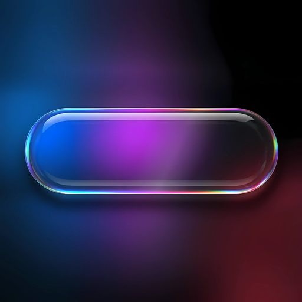
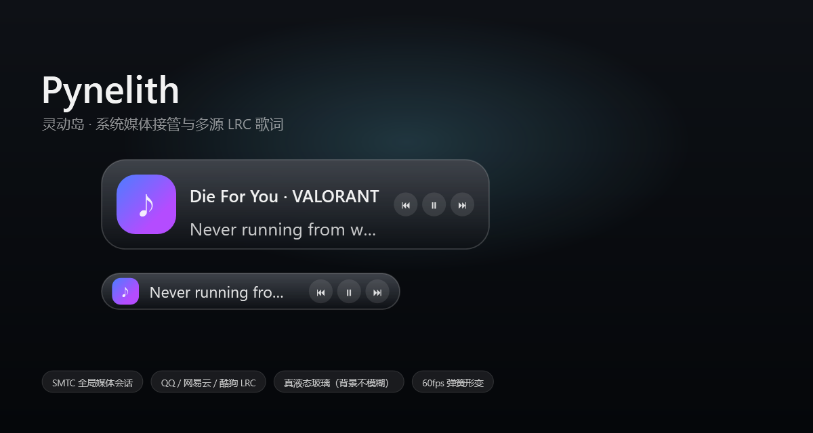

<div align="center">



# Pynelith

**Windows 桌面的时间胶囊 · 系统监控 · 媒体伴侣**

在屏幕顶部悬浮一枚会呼吸的胶囊：平时是时钟和 CPU / 内存仪表，播放音乐时自动形变为
封面与逐行歌词，点一下展开详情，全程 60fps。

[](https://github.com/5y2znfz2df-del/Pynelith/actions/workflows/build.yml)
[](https://github.com/5y2znfz2df-del/Pynelith/releases/latest)
[](https://github.com/5y2znfz2df-del/Pynelith/releases)
[](https://dotnet.microsoft.com/)
[](#快速开始)
[](LICENSE)
[](#roadmap)



</div>

---

## 为什么是 Pynelith

市面上的"Windows 灵动岛"大多只是一个会动的圆角矩形，或者一个只能控制音乐的挂件。
Pynelith 的做法是：**先让它在不播放任何东西时也有用**，再把玻璃和音乐做到位。

**① 首先是一枚时间与状态胶囊**
时钟、CPU 与内存占用常驻显示，每一段都能单独开关；胶囊宽度随内容自适应，
全部关掉就只剩一枚最小胶囊，不占视野。点一下待机胶囊，还能展开大时钟与日期。

**② 三套主题，按机器与喜好选**
液态玻璃 / 纯黑 / 磨砂一键切换：玻璃主题做抓屏折射与色散；纯黑与磨砂完全不做屏幕采样，
零抓屏开销，适合低配机器、远程桌面和 OLED 屏。

**③ 真液态玻璃，不是毛玻璃**
背景**保持清晰**，只在边缘做折射与色散——像一块真的玻璃压住了桌面。渲染能力全部封装在独立模块
`Pynelith.Glass` 里，UI 层零着色器、零 Composition 代码，一行调用即可把玻璃贴在任意元素上。

**④ 接管系统媒体，而不是轮询某个播放器**
基于 SMTC（System Media Transport Controls）自动扫描全局会话，优先跟随"正在播放"的那一个。
换歌、播放状态、封面、时间轴全部实时同步；播放器退出后自动回到待机，不会残留暂停界面。

**⑤ 歌词是真对齐的**
QQ 音乐 / 网易云 / 酷狗 三源自动匹配（标题 + 歌手 + 时长择优），本地缓存，手动导入兜底；
再配一个随时可调的时间偏移——即使歌词源和你的音频版本不同，也能在 10 秒内对齐。

## 特性

<table>
<tr><td width="50%" valign="top">

**外观**
- 三套主题：液态玻璃 / 纯黑 / 磨砂
- 真液态玻璃：清晰背景 + 边缘折射 + 色散
- 字体优先使用系统已安装的苹方 SC，未安装时回退微软雅黑（不内置第三方字体）
- 灵动岛高光：左上柔光 + 镜面边缘反光，展开时增强
- 圆角随尺寸自适应，封面按真实圆角裁剪
- 深色 / 浅色双套图标与配色
- 贴顶居中停靠，支持拖动改位置

**动画**
- 阻尼弹簧形变（固定子步长积分，帧率无关）
- 双层固定布局交叉淡入，动画帧内**零布局重算**
- 玻璃几何刷新节流，把 CPU 留给合成
- 60fps，无跳变、无抽搐

</td><td width="50%" valign="top">

**媒体**
- SMTC 自动扫描 / 跟随 / 播放控制
- 专辑封面、曲名、歌手、播放进度
- 空闲时自动收起为时间胶囊
- 点击胶囊展开 Apple Music 风格完整面板
- 进度拖拽跳转、系统音量、随机 / 循环模式

**歌词**
- 三源自动匹配，本地磁盘缓存
- 手动导入 LRC，立即生效
- 右键 200ms 步进微调整体偏移
- 过滤"作词/作曲/版权"等制作信息行

</td></tr>
</table>

**消息**
- 所有系统通知直接进岛，无黑白名单过滤
- 到达即自动展开，完整显示应用名与正文
- 文本自动换行、按内容测高，超长消息逐级缩字号不截断
- 停留约 5 秒后平滑收回，无需任何点击

**实用**
- 时钟常驻显示，可单独开关；点击待机胶囊展开大时钟与日期
- 待机与媒体两种形态都支持点击展开 / 收起
- CPU / 内存实时占用（1 秒采样，超过 85% 变色警示）
- 待机文字与资源监控均可隐藏，胶囊宽度随内容自适应
- 播放器退出（含网易云完全退出）后自动回到待机，无残留界面
- 兼容模式：液态玻璃下开启后，岛在截图与录屏中可见（自动退化为静态磨砂底）

**工程**
- 独立设置窗口，所有参数即时生效（JSON 配置，防抖落盘）
- 设置窗口采用 macOS 交通灯（关闭 / 缩小 / 放大）与无边框圆角外壳
- 位置与 Z 序守护：拦截外部 `SetWindowPos`，防止点击后被系统搬走、被其它窗口遮挡
- 遵循系统「显示动画」辅助功能设置，关闭后所有形变直接落位
- 展开面板支持键盘操作（空格 / ←→ / ↑↓ / Esc）
- 自带原生安装器：管理员提权、系统文件夹对话框选路径、进度/错误反馈、控制面板可卸载

## 快速开始

### 方式一：安装包（推荐）

前往 **[GitHub Releases](https://github.com/5y2znfz2df-del/Pynelith/releases/latest)** 下载最新安装包 →
双击 → UAC 允许 → 选择安装位置 → 安装。

安装器会释放程序、创建桌面与开始菜单快捷方式、注册卸载信息与登录自启，
完成后自动启动灵动岛。安装包约 **6.8MB**（程序载荷压缩内嵌）。
**目标机器需要安装 [.NET 8 桌面运行时](https://dotnet.microsoft.com/download/dotnet/8.0)**，
否则双击时会由系统提示下载。

> 安装包与仓库都**不附带** Apple 苹方字体。界面优先使用系统已安装的 PingFang SC，
> 未安装时回退到微软雅黑；请自行取得字体授权后在本机安装。

### 方式二：从源码构建

```bash
# 环境：Windows 10/11 + .NET 8 SDK
git clone https://github.com/5y2znfz2df-del/Pynelith.git
cd Pynelith

dotnet build src/Pynelith.Island/Pynelith.Island.csproj -c Release
dotnet run  --project src/Pynelith.Island/Pynelith.Island.csproj -c Release
```

构建安装包：

```bash
# 1) 发布主程序（框架依赖单文件，也就是安装器内嵌的载荷）
dotnet publish src/Pynelith.Island/Pynelith.Island.csproj -c Release -r win-x64 \
  --self-contained false

# 2) 发布安装器（构建时会自动把上一步的 exe 压缩成 zip 再内嵌）
dotnet publish src/Pynelith.Setup/Pynelith.Setup.csproj -c Release
```

## 使用

| 操作 | 效果 |
| --- | --- |
| 系统通知到达 | 岛自动展开显示完整正文，约 5 秒后自动收起 |
| 左键单击胶囊（待机） | 展开 / 收起大时钟、日期与资源占用 |
| 左键单击胶囊（播放中） | 展开 / 收起 Apple Music 风格播放面板 |
| 点击 ⏮ ⏸ ⏭ | 上一首 / 播放暂停 / 下一首（经 SMTC） |
| 拖动进度条 | 跳转到任意播放位置 |
| 拖动音量条 | 调整系统输出音量（与任务栏音量同步） |
| 点击随机 / 循环 | 切换随机播放；循环依次为 关闭 → 列表 → 单曲 |
| 面板内键盘 | 空格播放/暂停、←→ 快退快进 5 秒、↑↓ 音量、Esc 收起 |
| 设置 → 外观 → 兼容模式 | 截图 / 录屏时能看到灵动岛（关闭实时玻璃） |
| 拖动胶囊 | 改变停靠位置（自动写回配置） |
| 右键胶囊 | 歌词提前 / 延后 200ms、归零、设置、退出 |

不播放音乐时，胶囊显示**时间**、待机文字与 **CPU / 内存**占用；三者可在
设置 →「显示内容」里分别开关，胶囊宽度会跟着内容自动收缩。

配置位于 `%AppData%\Pynelith\config.json`，歌词缓存位于 `%AppData%\Pynelith\lyrics`。

## 开机自启与卸载

安装完成后安装器会**立即启动灵动岛**，并写入当前用户的登录自启项
（`HKCU\Software\Microsoft\Windows\CurrentVersion\Run`），下次登录自动恢复运行。
程序带单实例保护，重复启动不会出现第二个岛。

卸载有三个入口：

- 安装程序底部的「卸载已安装版本」
- Windows 设置 → 应用 → 已安装的应用 → Pynelith → 卸载
- 安装目录下的 `uninstall.exe`

卸载会一并清除：程序文件、桌面 / 开始菜单快捷方式、开机自启项、
`%AppData%\Pynelith`（配置、歌词缓存、崩溃日志）以及单文件运行时产生的临时解包目录。

<details>
<summary><b>主要配置项</b></summary>

| 字段 | 说明 |
| --- | --- |
| `Theme` | 界面主题：`LiquidGlass` / `PureBlack` / `Frosted` |
| `ShowClock` / `ShowIdleHint` / `ShowSystemMetrics` | 空闲态时间 / 待机文字 / 资源监控开关 |
| `GlobalScale` | 全局缩放（0.5 – 2.0），同时作用于尺寸与排版 |
| `CollapsedWidth` / `CollapsedHeight` | 空闲胶囊尺寸（默认 180 × 26，实际宽度不小于内容宽度） |
| `ExpandedWidth` | 媒体态宽度（默认 200，高度始终等于空闲高度） |
| `ScreenOffsetX` / `ScreenOffsetY` | 相对"贴顶居中"的偏移 |
| `GlassBlurStrength` | 玻璃染色浓度 0 – 1 |
| `CornerRadius` | 玻璃圆角 |
| `AnimationDurationMs` | 形变动画时长（0 = 关闭动画） |
| `LyricsEnabled` | 是否显示歌词行 |
| `LyricsSourceNetease` / `LyricsSourceQQ` / `LyricsSourceKugou` | 三源开关 |
| `LyricOffsetMs` | 歌词整体偏移（正值 = 提前） |
| `NotificationDurationMs` | 消息在岛内停留时长（默认 5000ms） |
| `TakeoverNotifications` | 接管系统通知 |

</details>

## 技术栈

| 层 | 选型 |
| --- | --- |
| 运行时 | .NET 8 / WPF（`net8.0-windows10.0.19041.0`） |
| 玻璃渲染 | `Pynelith.Glass`：Win32 + DWM 合成、GDI 抓屏采样、WPF 图层注入 |
| 媒体 | WinRT SMTC（`GlobalSystemMediaTransportControlsSessionManager`） |
| 系统监控 | Win32 `GetSystemTimes` + `GlobalMemoryStatusEx`，1 秒采样，零额外依赖 |
| 动画 | `DispatcherTimer` 驱动的阻尼弹簧 + 固定子步长积分 |
| 窗口 | 无边框分层窗口、`WM_WINDOWPOSCHANGING` 拦截、`SetWindowPos` 置顶守护 |
| 字体 | 系统字体栈：PingFang SC → Microsoft YaHei UI → Segoe UI；不内置第三方字体 |
| 配置 | `System.Text.Json`，单实例 + 防抖落盘 |
| 安装器 | WinForms 自研：`requireAdministrator`、文件夹选择、zip 压缩内嵌载荷（约 6.8MB） |

## 项目结构

```
Pynelith/
├─ src/
│  ├─ Pynelith.Glass/      # 液态玻璃渲染模块（对外只有 Install / Update）
│  ├─ Pynelith.Island/     # 灵动岛本体：时钟、系统监控、停靠、形变、媒体、歌词、设置
│  └─ Pynelith.Setup/      # 原生安装器（自包含单文件 + 内嵌载荷）
├─ assets/icon/            # 图标 SVG / ICO / 多尺寸 PNG + 使用规范
├─ docs/preview.png        # README 预览图
├─ demo/                   # 渲染模块示例
└─ Directory.Build.props   # 统一编译配置
```

> 安装器项目在缺少载荷时会自动执行一次 Island 发布，因此干净的 clone 直接
> `dotnet build Pynelith.sln -c Release` 也能通过。

## 复用 Pynelith.Glass

`Pynelith.Glass` 是一个独立的 WPF 玻璃层，不依赖 Pynelith.Island，可以贴到任意
`FrameworkElement` 上（卡片、侧边栏、控制台、播放器……）。渲染全部封装在模块内部，
UI 层不需要写任何着色器或 Composition 代码。

```csharp
using Pynelith.Glass.Effects;

var glass = LiquidGlassSurface.Install(card, new LiquidGlassSurface.LiquidGlassStyle
{
    CornerRadius = 28,          // 与卡片圆角一致
    BezelWidth = 18,            // 边缘折射带宽度
    Thickness = 26,             // 玻璃厚度（影响折射位移）
    Dispersion = 0.06,          // 色散强度
    TintAmount = 0.7,
    LightFollowsCursor = true,  // 高光跟随鼠标
    ExcludeFromCapture = false, // true：截图与录屏中不可见
});

// 卡片尺寸/圆角由布局决定，玻璃会跟随刷新
// 退出或切换主题时释放
glass.Dispose();
```

窗口级背景（不想贴具体元素时）：

```csharp
using Pynelith.Glass;

using IGlassSurface backdrop = GlassRenderer.Attach(window, new GlassOptions
{
    BlurStrength = 0.6,
    TintOpacity = 0.55,
});
```

- 支持 Windows 10 1809+ / Windows 11；自动选择 System Backdrop → Composition Blur → 旧版 Blur 回退链。
- 纯 WPF + Win32 互操作，无第三方运行时依赖。
- 与主项目同为 MIT，欢迎拿去用到别的项目；如果它帮到了你，回来给 Pynelith 点个 ⭐ 就好。

## 已知限制

- **播放器不报进度时无法自动对齐**：例如网易云的 SMTC 时间轴恒为 0，此时以"换歌事件"作为
  0 点推算，个别曲目仍需用右键偏移手动校准一次。Spotify、QQ 音乐等会上报进度的播放器无需手动干预。
- **消息展示依赖系统授权**：首次运行需要在「系统设置 → 通知 → 通知访问」中允许 Pynelith，
  否则读取不到系统通知（设置页「通知与提示」里有直达链接）。
- **玻璃抓屏与动画共用 UI 线程**：玻璃层在 UI 线程做 BitBlt 采样（约 24fps），因此形变动画中
  偶有 1–3 帧被拉长到 35ms 左右。已通过几何刷新节流把影响压到最小。

## Roadmap

- [ ] 更多实用小组件（电量、网速、天气）
- [ ] 逐字（卡拉 OK）歌词高亮
- [ ] 通知接管的完整落地（当前为 SMTC + 通知桥骨架）
- [ ] 多显示器与逐屏 DPI 边界情况
- [ ] 主题跟随系统自动切换深浅图标
- [ ] 玻璃采样移出 UI 线程，彻底消除长帧

## 贡献

欢迎 Issue 与 PR。开始之前请阅读：

- [CONTRIBUTING.md](CONTRIBUTING.md) —— 构建、调试与提交规范
- [CODE_OF_CONDUCT.md](CODE_OF_CONDUCT.md) —— 社区行为准则

CI 会在每次 push / PR 上执行 `dotnet build`，提交前也建议本地跑一遍。

## 版权与致谢

- **代码**：[MIT](LICENSE) © 2026 FBOJ 与 Pynelith 贡献者。
- **字体**：仓库与安装包不包含 Apple 苹方（PingFang SC）。界面优先读取系统已安装的苹方，
  否则回退微软雅黑。苹方是 Apple Inc. 的商标与授权字体，请通过正规渠道取得授权后在本机安装；
  第三方网盘或代码托管站转载的字体包不构成 Apple 授权，请勿据此再分发。
- **设计灵感**：Apple Human Interface Guidelines、iOS 灵动岛、macOS 交通灯窗口。
- **技术**：.NET 8 / WPF、Windows SMTC、WASAPI、Pynelith.Glass。
- **同类项目研究**：Xiaoyu-Windows-DynamicIsland、eIsland、winfinger-windows-island、
  Quick Pill、Lyricify / AMLL。
- 感谢所有 Issue、PR 与反馈。

## License

[MIT](LICENSE) © 2026 FBOJ and Pynelith contributors

<div align="center">
<sub>如果 Pynelith 让你的桌面好看了一点，欢迎点个 ⭐</sub>
</div>
