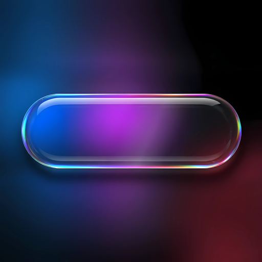
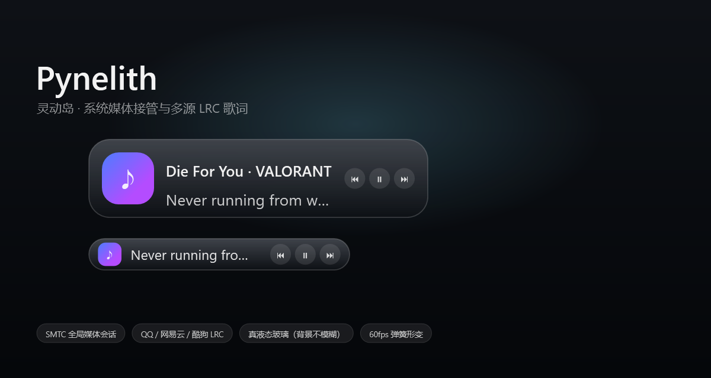

<div align="center">



# Pynelith

**Windows 桌面的时间胶囊 · 系统监控 · 媒体伴侣**

在屏幕顶部悬浮一枚会呼吸的胶囊：平时是时钟和 CPU / 内存仪表，播放音乐时自动形变为
封面与逐行歌词，点一下展开详情，全程 60fps。

[](https://github.com/5y2znfz2df-del/Pynelith/actions/workflows/build.yml)
[](https://github.com/5y2znfz2df-del/Pynelith/releases/latest)
[](https://github.com/5y2znfz2df-del/Pynelith/releases)
[](https://dotnet.microsoft.com/)
[](#快速开始)
[](LICENSE)
[](#roadmap)



</div>

---

## 为什么是 Pynelith

市面上的"Windows 灵动岛"大多只是一个会动的圆角矩形，或者一个只能控制音乐的挂件。
Pynelith 的做法是：**先让它在不播放任何东西时也有用**，再把玻璃和音乐做到位。

**① 首先是一枚时间与状态胶囊**
时钟、CPU 与内存占用常驻显示，每一段都能单独开关；胶囊宽度随内容自适应，
全部关掉就只剩一枚最小胶囊，不占视野。点一下待机胶囊，还能展开大时钟与日期。

**② 三套主题，按机器与喜好选**
液态玻璃 / 纯黑 / 磨砂一键切换：玻璃主题做抓屏折射与色散；纯黑与磨砂完全不做屏幕采样，
零抓屏开销，适合低配机器、远程桌面和 OLED 屏。

**③ 真液态玻璃，不是毛玻璃**
背景**保持清晰**，只在边缘做折射与色散——像一块真的玻璃压住了桌面。渲染能力全部封装在独立模块
`Pynelith.Glass` 里，UI 层零着色器、零 Composition 代码，一行调用即可把玻璃贴在任意元素上。

**④ 接管系统媒体，而不是轮询某个播放器**
基于 SMTC（System Media Transport Controls）自动扫描全局会话，优先跟随"正在播放"的那一个。
换歌、播放状态、封面、时间轴全部实时同步；播放器退出后自动回到待机，不会残留暂停界面。

**⑤ 歌词是真对齐的**
QQ 音乐 / 网易云 / 酷狗 三源自动匹配（标题 + 歌手 + 时长择优），本地缓存，手动导入兜底；
再配一个随时可调的时间偏移——即使歌词源和你的音频版本不同，也能在 10 秒内对齐。

## 特性

<table>
<tr><td width="50%" valign="top">

**外观**
- 三套主题：液态玻璃 / 纯黑 / 磨砂
- 真液态玻璃：清晰背景 + 边缘折射 + 色散
- 内置苹方 SC 子集（正文中黑 / 标题粗体），无需安装
- 灵动岛高光：顶部窄弧反光 + 上缘渐变描边，腰身不描边、无整圈白边
- 圆角随尺寸自适应，封面按真实圆角裁剪
- 深色 / 浅色双套图标与配色
- 贴顶居中停靠，支持拖动改位置

**动画**
- 阻尼弹簧形变（固定子步长积分，帧率无关）
- 双层固定布局交叉淡入，动画帧内**零布局重算**
- 玻璃几何刷新节流，把 CPU 留给合成
- 60fps，无跳变、无抽搐

</td><td width="50%" valign="top">

**媒体**
- SMTC 自动扫描 / 跟随 / 播放控制
- 专辑封面、曲名、歌手、播放进度
- 空闲时自动收起为时间胶囊
- 点击胶囊展开 Apple Music 风格完整面板
- 进度拖拽跳转、系统音量、随机 / 循环模式

**歌词**
- 三源自动匹配，本地磁盘缓存
- **逐字（卡拉 OK）高亮**：QRC / YRC 逐字时间戳直接解析，普通 LRC 按字数插值
- 手动导入 LRC，立即生效
- 右键 200ms 步进微调整体偏移
- 过滤"作词/作曲/版权"等制作信息行

</td></tr>
</table>

**消息**
- 所有系统通知直接进岛，无黑白名单过滤
- 到达即自动展开，完整显示应用名与正文
- 文本自动换行、按内容测高，超长消息逐级缩字号不截断
- 停留约 5 秒后平滑收回，无需任何点击
- **按应用分组的历史记录**：最近 200 条 / 7 天，设置页可直接回看与清空


**Siri 语音助手**
- 可插拔独立组件：设置页一键启用 / 禁用，不侵入岛的核心逻辑
- 唤醒词可自定义（默认「嘿 Siri」），后台离线监听（Vosk 中文小模型）
- 圆形液态玻璃透镜：上半边深色玻璃、下半边纯透明玻璃，中间渐变过渡，两区都实时折射桌面；中心横向色散光带（无底框，只有一颗玻璃球）
- 光带跟随状态：收音脉动、生成流动、空闲呼吸、结束收拢
- 语音输入 + 文字输入双通道，流式逐字回复，随时停止生成
- 全局快捷键（默认 Ctrl+Alt+S）或点击胶囊右端光点唤起
- 与其它面板互斥；低配 GPU 模式可一键关闭折射

**实用**
- 时钟常驻显示，可单独开关；点击待机胶囊展开大时钟与日期
- 待机与媒体两种形态都支持点击展开 / 收起
- CPU / 内存实时占用（1 秒采样，超过 85% 变色警示）
- 待机文字与资源监控均可隐藏，胶囊宽度随内容自适应
- 播放器退出（含网易云完全退出）后自动回到待机，无残留界面
- 兼容模式：液态玻璃下开启后，窗口不再被排除出捕获，截图与录屏里能看到岛；折射、色散与边缘高光与常规模式完全一致（采样时遮掉自身区域，避免自反馈）
- 系统托盘常驻：双击打开设置，右键菜单可设置或退出
- **多显示器**：可指定停靠在哪一块屏；混合缩放（100% + 150%）下按目标屏自己的 DPI 计算位置
- **跟随系统深浅色**：纯黑 / 磨砂在浅色系统下自动换成浅色配色，图标与文字同步反相

**工程**
- 独立设置窗口，所有参数即时生效（JSON 配置，防抖落盘）
- 渲染走 GPU：WPF 硬件渲染（D3D9Ex），并向系统登记「高性能」图形首选项，优先独显 → 核显 → 软件渲染；无需手动设置
- **玻璃抓屏在独立工作线程**：BitBlt 不在 UI 线程执行，形变动画不因采样被拉长；采样请求自动合并降帧
- 设置窗口采用 macOS 交通灯（关闭 / 缩小 / 放大）与无边框圆角外壳
- 位置与 Z 序守护：拦截外部 `SetWindowPos`，防止点击后被系统搬走、被其它窗口遮挡
- 遵循系统「显示动画」辅助功能设置，关闭后所有形变直接落位
- 展开面板支持键盘操作（空格 / ←→ / ↑↓ / Esc）
- 自带原生安装器：管理员提权、系统文件夹对话框选路径、进度/错误反馈、控制面板可卸载

## 快速开始

### 方式一：安装包（推荐）

前往 **[GitHub Releases](https://github.com/5y2znfz2df-del/Pynelith/releases/latest)** 下载最新安装包 →
双击 → UAC 允许 → 选择安装位置 → 安装。

安装器会释放程序、创建桌面与开始菜单快捷方式、注册卸载信息与登录自启，
完成后自动启动灵动岛。安装包约 **23MB**（程序载荷 + 嵌入字体压缩内嵌）。
**目标机器需要安装 [.NET 8 桌面运行时](https://dotnet.microsoft.com/download/dotnet/8.0)**，
否则双击时会由系统提示下载。

> 安装包内置苹方 SC 子集。PingFang 是 Apple Inc. 的商标与授权字体；
> 本项目依据维护者提供的授权声明分发，若你要再分发请自行确认授权范围。

### 方式二：从源码构建

```bash
# 环境：Windows 10/11 + .NET 8 SDK
git clone https://github.com/5y2znfz2df-del/Pynelith.git
cd Pynelith

dotnet build src/Pynelith.Island/Pynelith.Island.csproj -c Release
dotnet run  --project src/Pynelith.Island/Pynelith.Island.csproj -c Release
```

构建安装包：

```bash
# 1) 发布主程序（框架依赖单文件，也就是安装器内嵌的载荷）
dotnet publish src/Pynelith.Island/Pynelith.Island.csproj -c Release -r win-x64 \
  --self-contained false

# 2) 发布安装器（构建时会自动把上一步的 exe 压缩成 zip 再内嵌）
dotnet publish src/Pynelith.Setup/Pynelith.Setup.csproj -c Release
```

## 使用

| 操作 | 效果 |
| --- | --- |
| 系统通知到达 | 岛自动展开显示完整正文，约 5 秒后自动收起 |
| 左键单击胶囊（待机） | 展开 / 收起大时钟、日期与资源占用 |
| 左键单击胶囊（播放中） | 展开 / 收起 Apple Music 风格播放面板 |
| 点击 ⏮ ⏸ ⏭ | 上一首 / 播放暂停 / 下一首（经 SMTC） |
| 拖动进度条 | 跳转到任意播放位置 |
| 拖动音量条 | 调整系统输出音量（与任务栏音量同步） |
| 点击随机 / 循环 | 切换随机播放；循环依次为 关闭 → 列表 → 单曲 |
| 面板内键盘 | 空格播放/暂停、←→ 快退快进 5 秒、↑↓ 音量、Esc 收起 |
| 设置 → 外观 → 兼容模式 | 截图 / 录屏时能看到灵动岛，折射 / 色散 / 边缘高光与常规模式一致 |
| 拖动胶囊 | 改变停靠位置（自动写回配置） |
| 右键胶囊 | 歌词提前 / 延后 200ms、归零、设置、退出 |

不播放音乐时，胶囊显示**时间**、待机文字与 **CPU / 内存**占用；三者可在
设置 →「显示内容」里分别开关，胶囊宽度会跟着内容自动收缩。

配置位于 `%AppData%\Pynelith\config.json`，歌词缓存位于 `%AppData%\Pynelith\lyrics`。

## Siri 语音助手

Siri 不是写死在岛里的功能，而是一个**可插拔组件**：设置 →「Siri」里可以整体启用 / 禁用，
关闭后不加载唤醒模型、不占用麦克风、不监听快捷键。

- **唤醒**：默认「嘿 Siri」，可在设置里改成任意唤醒词；唤醒词识别使用
  [Vosk](https://alphacephei.com/vosk/) 离线中文小模型，首次启用时自动下载到
  `%AppData%\Pynelith\vosk\`（约 40MB，之后完全离线，不消耗任何 API 额度）。
- **唤起方式**：语音唤醒、全局快捷键（默认 `Ctrl+Alt+S`）、点击胶囊右端光点，三者互不冲突；
  快捷键按一次开始收音，再按一次结束并转写（说完静音约 1 秒也会自动结束）；
  只想用快捷键时，把「后台语音唤醒」关掉即可。
- **对话**：语音先经 ASR 转文字，再走 OpenAI 兼容的 `/chat/completions` 流式接口逐字回复；
  也可以直接在透镜里打字。生成过程中可随时停止，历史记录自动保存。
- **API 由你自己填**：设置页提供 API Key、Base URL、模型名称、上下文轮数；
  ASR 区留空则复用对话 API 的地址与 Key。**程序不内置任何密钥、也不内置任何中转接口。**
- **性能**：透镜折射与色散可被「低配 GPU 模式」一键关闭（不再抓屏），
  只保留光带与文字，适合 MX330 这类低配显卡；光带与折射都有独立帧率上限。

Siri 的配置与对话历史分别保存在 `%AppData%\Pynelith\siri.json` 与 `siri-history.json`，
与岛的主配置 `config.json` 完全独立。MCP 工具调用接口目前只做预留，尚未接入。

## 开机自启与卸载

安装完成后安装器会**立即启动灵动岛**，并写入当前用户的登录自启项
（`HKCU\Software\Microsoft\Windows\CurrentVersion\Run`），下次登录自动恢复运行。
程序带单实例保护，重复启动不会出现第二个岛。

卸载有三个入口：

- 安装程序底部的「卸载已安装版本」
- Windows 设置 → 应用 → 已安装的应用 → Pynelith → 卸载
- 安装目录下的 `uninstall.exe`

卸载会一并清除：程序文件、桌面 / 开始菜单快捷方式、开机自启项、
`%AppData%\Pynelith`（配置、歌词缓存、崩溃日志）以及单文件运行时产生的临时解包目录。

<details>
<summary><b>主要配置项</b></summary>

| 字段 | 说明 |
| --- | --- |
| `Theme` | 界面主题：`LiquidGlass` / `PureBlack` / `Frosted` |
| `ShowClock` / `ShowIdleHint` / `ShowSystemMetrics` | 空闲态时间 / 待机文字 / 资源监控开关 |
| `GlobalScale` | 全局缩放（0.5 – 2.0），同时作用于尺寸与排版 |
| `CollapsedWidth` / `CollapsedHeight` | 空闲胶囊尺寸（默认 180 × 26，实际宽度不小于内容宽度） |
| `ExpandedWidth` | 媒体态宽度（默认 200，高度始终等于空闲高度） |
| `ScreenOffsetX` / `ScreenOffsetY` | 相对"贴顶居中"的偏移 |
| `GlassBlurStrength` | 玻璃染色浓度 0 – 1 |
| `CornerRadius` | 玻璃圆角 |
| `AnimationDurationMs` | 形变动画时长（0 = 关闭动画） |
| `LyricsEnabled` | 是否显示歌词行 |
| `LyricsSourceNetease` / `LyricsSourceQQ` / `LyricsSourceKugou` | 三源开关 |
| `LyricOffsetMs` | 歌词整体偏移（正值 = 提前） |
| `NotificationDurationMs` | 消息在岛内停留时长（默认 5000ms） |
| `TakeoverNotifications` | 接管系统通知 |
| `MonitorIndex` | 停靠屏幕：`-1` 自动跟随 / `0..N` 指定第 N 块 |
| `FollowSystemTheme` | 跟随系统深浅色自动切换配色（默认开启） |
| `ProgressOffsetPresetId` | 进度对齐预设（`netease-default` / `netease-sq` / `netease-lossless`） |

Siri 组件使用独立配置文件 `%AppData%\Pynelith\siri.json`（唤醒词、麦克风、灵敏度、
对话 / ASR 的 Key、Base URL 与模型、上下文轮数、快捷键、低配 GPU 模式），
在设置 →「Siri」里修改，不写入 `config.json`。

</details>

## 技术栈

| 层 | 选型 |
| --- | --- |
| 运行时 | .NET 8 / WPF（`net8.0-windows10.0.19041.0`） |
| 玻璃渲染 | `Pynelith.Glass`：Win32 + DWM 合成、GDI 抓屏采样（独立工作线程）、WPF 图层注入 |
| 媒体 | WinRT SMTC（`GlobalSystemMediaTransportControlsSessionManager`） |
| 语音 | NAudio（WASAPI 采集）+ Vosk（离线中文唤醒词模型）+ OpenAI 兼容流式接口 |
| 系统监控 | Win32 `GetSystemTimes` + `GlobalMemoryStatusEx`，1 秒采样，零额外依赖 |
| 动画 | `DispatcherTimer` 驱动的阻尼弹簧 + 固定子步长积分 |
| 窗口 | 无边框分层窗口、`WM_WINDOWPOSCHANGING` 拦截、`SetWindowPos` 置顶守护 |
| 字体 | 苹方 SC 子集（中黑 / 粗体）作为 WPF 资源嵌入，pack URI 引用 |
| 配置 | `System.Text.Json`，单实例 + 防抖落盘 |
| 安装器 | WinForms 自研：`requireAdministrator`、文件夹选择、zip 压缩内嵌载荷（约 23MB） |

## 项目结构

```
Pynelith/
├─ src/
│  ├─ Pynelith.Glass/      # 液态玻璃渲染模块（对外只有 Install / Update）
│  ├─ Pynelith.Island/     # 灵动岛本体：时钟、系统监控、停靠、形变、媒体、歌词、Siri、设置
│  └─ Pynelith.Setup/      # 原生安装器（自包含单文件 + 内嵌载荷）
├─ assets/icon/            # 图标 SVG / ICO / 多尺寸 PNG + 使用规范
├─ docs/preview.png        # README 预览图
├─ demo/                   # 渲染模块示例
└─ Directory.Build.props   # 统一编译配置
```

> 安装器项目在缺少载荷时会自动执行一次 Island 发布，因此干净的 clone 直接
> `dotnet build Pynelith.sln -c Release` 也能通过。

## 复用 Pynelith.Glass

`Pynelith.Glass` 是一个独立的 WPF 玻璃层，不依赖 Pynelith.Island，可以贴到任意
`FrameworkElement` 上（卡片、侧边栏、控制台、播放器……）。渲染全部封装在模块内部，
UI 层不需要写任何着色器或 Composition 代码。

```csharp
using Pynelith.Glass.Effects;

var glass = LiquidGlassSurface.Install(card, new LiquidGlassSurface.LiquidGlassStyle
{
    CornerRadius = 28,          // 与卡片圆角一致
    BezelWidth = 18,            // 边缘折射带宽度
    Thickness = 26,             // 玻璃厚度（影响折射位移）
    Dispersion = 0.06,          // 色散强度
    TintAmount = 0.7,
    LightFollowsCursor = true,  // 高光跟随鼠标
    ExcludeFromCapture = false, // true：截图与录屏中不可见；false：可见且折射照常
});

// 卡片尺寸/圆角由布局决定，玻璃会跟随刷新
// 退出或切换主题时释放
glass.Dispose();
```

窗口级背景（不想贴具体元素时）：

```csharp
using Pynelith.Glass;

using IGlassSurface backdrop = GlassRenderer.Attach(window, new GlassOptions
{
    BlurStrength = 0.6,
    TintOpacity = 0.55,
});
```

- 支持 Windows 10 1809+ / Windows 11；自动选择 System Backdrop → Composition Blur → 旧版 Blur 回退链。
- 纯 WPF + Win32 互操作，无第三方运行时依赖。
- 与主项目同为 MIT，欢迎拿去用到别的项目；如果它帮到了你，回来给 Pynelith 点个 ⭐ 就好。

## 已知限制

- **播放器不报进度时只能近似对齐**：网易云的 SMTC 时间轴恒为 0。Pynelith 会读取播放器
  窗口标题的变化来捕捉更准的换歌时刻（比 SMTC 元数据事件更早），并内置「标准 / SQ / 无损」
  三档进度预设；个别版本仍可能差几十毫秒，用右键偏移微调即可。
- **消息展示依赖系统授权**：首次运行需要在「系统设置 → 通知 → 通知访问」中允许 Pynelith，
  否则读取不到系统通知（设置页「通知与提示」里有直达链接）。
- **不支持岛内回复**：Windows 的通知监听 API 不暴露通知的动作按钮，第三方应用无法代为触发
  原应用的"回复"动作，因此 v0.2.2 起移除了岛内回复输入，避免给出无法兑现的承诺。

## Roadmap

- [ ] 更多实用小组件（电量、网速、天气）
- [x] Siri 语音助手（离线唤醒 + 液态玻璃透镜 + 流式对话）
- [ ] MCP 工具调用接入
- [x] 逐字（卡拉 OK）歌词高亮
- [x] 通知接管的完整落地（按应用分组 + 历史记录 + 岛内回复输入）
- [x] 多显示器与逐屏 DPI 边界情况
- [x] 主题跟随系统自动切换深浅配色与图标
- [x] 玻璃采样移出 UI 线程，彻底消除长帧

## 0.3.0 更新

- **Siri 语音助手**：新增可插拔语音组件。圆形液态玻璃透镜（无底框）上半深色、下半透明，
  两区都实时折射桌面背景，中间渐变分界；中心横向色散光带随状态变化（收音脉动 / 生成流动 / 空闲呼吸 / 结束收拢）。
- **离线唤醒**：Vosk 中文小模型本地识别自定义唤醒词（默认「嘿 Siri」），
  首次启用自动下载，之后完全离线；语音、快捷键、点击胶囊三种唤起方式可分别开关。
- **流式对话**：兼容 OpenAI 协议的流式回复，支持逐字输出、随时停止、上下文轮数限制与本地历史。
- **API 全自定义**：Key、Base URL、模型与 ASR 端点全部由用户填写，程序不内置任何密钥或中转。
- **低配 GPU 模式**：一键关闭透镜折射与色散，只保留光带与文字。

## 0.2.2 更新

- **移除岛内回复 / 发送**：Windows 通知 API 不暴露动作按钮，无法真正发出回复；
  与其保留一个只能复制到剪贴板的功能，不如去掉输入框，通知历史仍然保留。
- **开机 / 解锁入场动画**：进入桌面或 Win+L 解锁后，胶囊从屏幕顶端下滑进入，
  缓动为"先快后慢"（CubicEase EaseOut）；随后在**胶囊内部**逐笔写出彩虹霓虹的 "hello"
  （期间时间 / 歌词 / 播放控件全部隐藏），停留片刻后淡出，胶囊恢复常驻。
  素材为从 Apple 激活动画录屏中提取并抠像的 45 帧精灵图，逐帧播放（50ms / 帧）；
  若胶囊被配置得很小，播放期间会临时撑开到能容纳字形的尺寸，播完自动收回。
- **开机自启更快**：GPU 偏好写入与托盘创建、SMTC 初始化都移出首屏关键路径；
  发布产物启用 ReadyToRun，减少首次启动的 JIT 开销。
- **修复播放时点击灵动岛导致整个岛消失**：逐字歌词改用 `Inline`/`Run` 渲染后，
  鼠标命中的 `OriginalSource` 可能是 `Run`（`ContentElement` 而非 `Visual`），
  点击判定直接调 `VisualTreeHelper.GetParent` 会抛 `InvalidOperationException`，
  未处理异常终止进程。点击判定改为按节点类型分别走视觉树与内容树。

## 0.2.1 更新

- **玻璃抓屏改用独立工作线程**：BitBlt 与像素处理全部移出 UI 线程，UI 只用一次
  `WritePixels` 上交已完成的帧；采样请求自动合并，抓屏慢时降帧而不是堆积。形变动画不再被拉长。
- **逐字（卡拉 OK）歌词**：QQ 音乐 QRC 与网易云 YRC 的逐字时间戳直接解析；普通 LRC 则按字数
  在行内均分做插值高亮。
- **通知接管补全**：通知结构化（标题 / 正文 / 分组键）、按应用分组的历史记录
  （`%AppData%\Pynelith\notifications.json`，7 天 / 200 条）、岛内回复输入框。
- **网易云进度兜底**：播放器画像识别 + 窗口标题变化捕捉换歌 0 点 + 音质版本进度预设。
- **多显示器与逐屏 DPI**：可指定停靠屏幕，混合缩放下按目标屏自己的 DPI 计算位置与采样。
- **跟随系统深浅色**：纯黑 / 磨砂在浅色系统下自动换成浅色配色，图标与文字同步反相。

## 贡献

欢迎 Issue 与 PR。开始之前请阅读：

- [CONTRIBUTING.md](CONTRIBUTING.md) —— 构建、调试与提交规范
- [CODE_OF_CONDUCT.md](CODE_OF_CONDUCT.md) —— 社区行为准则

CI 会在每次 push / PR 上执行 `dotnet build`，提交前也建议本地跑一遍。

## 版权与致谢

- **代码**：[MIT](LICENSE) © 2026 FBOJ 与 Pynelith 贡献者。
- **字体**：内置苹方 SC 子集（`src/Pynelith.Island/Fonts/`）。PingFang 是 Apple Inc. 的商标与授权字体，
  本项目依据维护者提供的授权声明分发；如需再分发或商用，请自行确认授权范围。
- **设计灵感**：Apple Human Interface Guidelines、iOS 灵动岛、macOS 交通灯窗口。
- **技术**：.NET 8 / WPF、Windows SMTC、WASAPI、Pynelith.Glass。
- **同类项目研究**：Xiaoyu-Windows-DynamicIsland、eIsland、winfinger-windows-island、
  Quick Pill、Lyricify / AMLL。
- 感谢所有 Issue、PR 与反馈。

## License

[MIT](LICENSE) © 2026 FBOJ and Pynelith contributors

<div align="center">
<sub>如果 Pynelith 让你的桌面好看了一点，欢迎点个 ⭐</sub>
</div>
